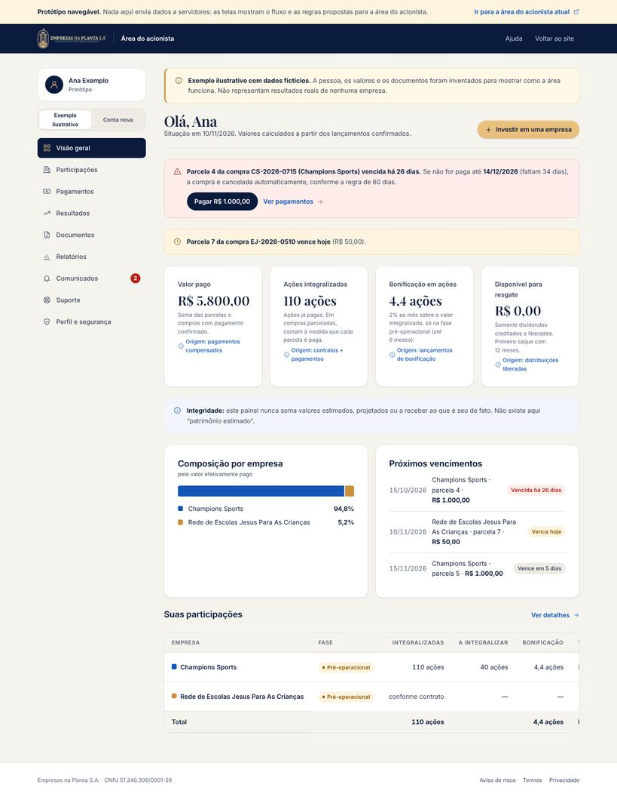
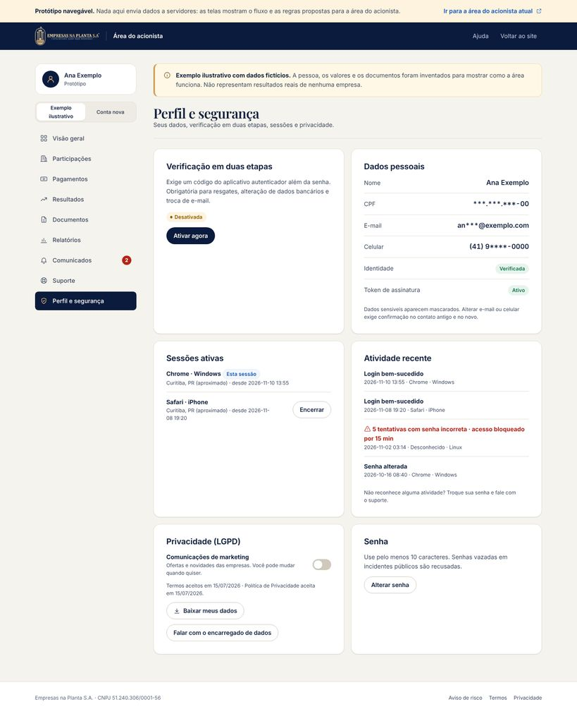
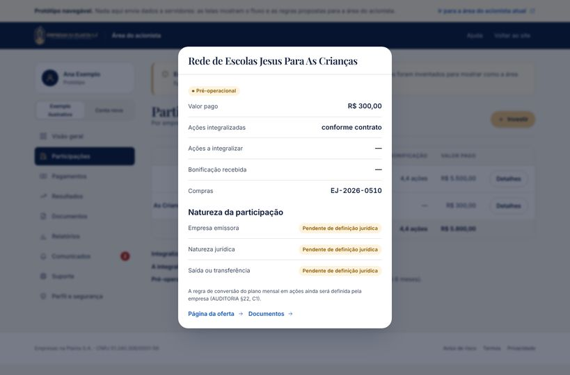
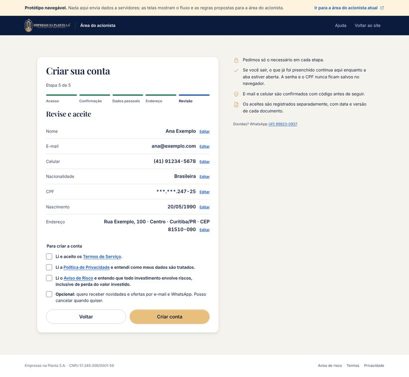
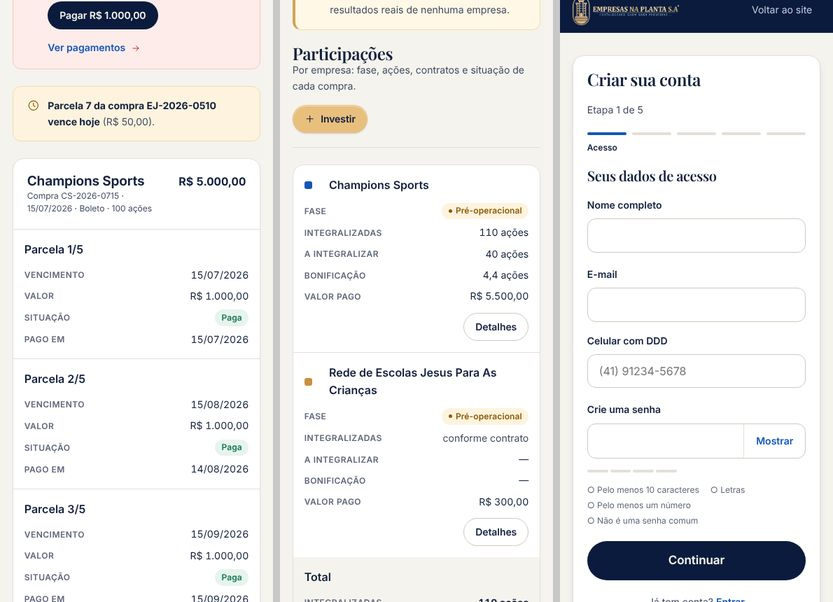

# Área do acionista — especificação e protótipo

Aplicação do documento *"Análise de melhorias — Empresas na Planta"* à área logada: painel do investidor, cadastro, login, usabilidade, segurança, proteção de dados e transparência.

**O que foi entregue:**
1. **Protótipo navegável** com 4 telas: [`/prototipo/area-do-acionista/`](dist/prototipo/area-do-acionista/index.html), [`/prototipo/entrar/`](dist/prototipo/entrar/index.html), [`/prototipo/cadastro/`](dist/prototipo/cadastro/index.html) e [`/prototipo/recuperar-senha/`](dist/prototipo/recuperar-senha/index.html).
2. **Contrato de dados** (`src/static/prototipo/dados/*.json`), que é o formato que o backend deve entregar.
3. **Esta especificação:** regras de cálculo, API, requisitos de segurança com critério de aceite, LGPD e plano por prioridade.

> **Limites (não declarar além do que foi verificado).** O protótipo roda inteiro no navegador e **não envia dados a servidores**. O portal real (`ia.empresasnaplanta.com.br`, PHP) **não foi alterado nem auditado por dentro**: código, servidor, banco e integrações continuam **NÃO VERIFICADOS**. A segurança só pode ser afirmada depois da auditoria técnica da seção 6.

---

## 1. Princípios

| # | Princípio | Como aparece no protótipo |
|---|---|---|
| 1 | **Cada número tem origem, significado e contexto** | Todo indicador mostra uma definição e a linha "Origem: …" |
| 2 | **Nada estimado é exibido como patrimônio** | Não existe "patrimônio estimado". "Disponível para resgate" soma apenas o que foi creditado **e** liberado |
| 3 | **Totais são calculados, nunca armazenados** | O painel soma parcelas pagas, ações integralizadas e bonificações a partir dos lançamentos. Os números sempre fecham |
| 4 | **Exemplos são rotulados como exemplos** | O modo "Exemplo ilustrativo" tem pessoa e valores fictícios e um aviso fixo; o modo "Conta nova" mostra os estados vazios reais |
| 5 | **Simples para o usuário, rigoroso no procedimento** | Cadastro em 5 etapas, confirmação de e-mail e celular, 2FA, aceites separados |
| 6 | **Mobile completo, não comprimido** | No celular, as tabelas viram cartões empilhados; as abas rolam na horizontal; os formulários usam teclado numérico onde cabe |

---

## 2. Arquitetura de informação

| Seção | Conteúdo | Correspondência no portal atual |
|---|---|---|
| **Visão geral** | Alertas (parcela vencida, vencimento hoje, identidade pendente), 4 indicadores com origem, composição por empresa, próximos vencimentos e resumo das participações | Página inicial após o login (NÃO VERIFICADO) |
| **Participações** | Por empresa: fase (pré-operacional/em operação), integralizadas, a integralizar, bonificação, valor pago; detalhe em diálogo com emissora, natureza jurídica e condições de saída | "MINHAS AÇÕES" |
| **Pagamentos** | Cada compra com suas parcelas: vencimento, valor, situação (paga, vence hoje, vence em N dias, vencida há N dias) e data de pagamento | "MEUS PAGAMENTOS" |
| **Resultados** | Distribuições de lucro (dividendos) e bonificações em ações, com a base de cálculo de cada linha; resgatar e reinvestir só com saldo liberado | Painel de dividendos / resgate |
| **Documentos** | Contratos (com data, hora e hash da assinatura por token), certificados, informes de rendimentos; filtro por tipo | Certificado de aquisição |
| **Relatórios** | Relatórios contábeis por empresa (acesso de auditoria) e atualizações dos projetos | "Relatório contábil" / "Painel Contábil" |
| **Comunicados** | Caixa de entrada com prioridade, lidos e não lidos e contador no menu | — (não existe hoje) |
| **Suporte** | Canais oficiais e abertura e acompanhamento de chamados | WhatsApp |
| **Perfil e segurança** | 2FA, dados mascarados, sessões ativas (encerrar), atividade recente com alertas, privacidade/LGPD (consentimento, exportação, encarregado), senha | Token de segurança |

---

## 3. Regras de cálculo (devem ser idênticas no backend)

| Indicador | Definição | Fórmula | Fonte |
|---|---|---|---|
| **Valor pago** | Dinheiro efetivamente recebido | Σ parcelas com `status = paga` | Pagamentos compensados (não "boleto emitido") |
| **Ações integralizadas** | Ações já pagas | Por compra: `round(ações × pago ÷ valor da compra)` (regra da FAQ: "passam a contar à medida que vão sendo pagas") | Contratos + pagamentos |
| **Ações a integralizar** | Ações de compras parceladas ainda não pagas | `ações da compra − integralizadas` | Idem |
| **Bonificação** | 2% ao mês sobre o valor integralizado, em ações, só na fase pré-operacional (até 6 meses) | `base × 0,02 ÷ preço da ação` | Lançamentos mensais (cada linha guarda a **base** usada, para conferência) |
| **Disponível para resgate** | Dividendos creditados **e** liberados | Σ distribuições com `status = liberado` | Distribuições |
| **Situação da parcela** | Paga / vence hoje / vence em N dias / vencida há N dias | Data de referência do servidor (não o relógio do celular) | Parcelas |
| **Prazo de cancelamento** | Atraso superior a 60 dias cancela a compra | `vencimento + 60 dias`, com dias restantes exibidos | Regra da FAQ |

**Exemplo verificável** (dados fictícios do protótipo, conferidos por `scripts/e2e-acionista.cjs`):
- Compra CS-2026-0715: 100 ações, R$ 5.000 em 5×, 3 parcelas pagas → R$ 3.000 pagos, 60 integralizadas e 40 a integralizar.
- Compra CS-2026-0902: 50 ações à vista → R$ 2.500 pagos e 50 integralizadas.
- Escolas: 6 parcelas de R$ 50 → R$ 300 pagos. A regra de conversão em ações está pendente; ver AUDITORIA §22, C1.
- **Totais:** R$ 5.800,00 pagos; 110 ações integralizadas; bonificação de 0,4 + 1,8 + 2,2 = 4,4 ações; R$ 0,00 disponível.
- Parcela 4, vencida em 15/10/2026 → em 10/11/2026 está "vencida há 26 dias", com cancelamento em 14/12/2026 (faltam 34 dias).

**Pendências de regra (decisão do cliente):** arredondamento de ações fracionárias (bonificação gera frações); a regra do plano mensal das escolas; se a bonificação incide sobre parcelas pagas no próprio dia do crédito.

---

## 4. Contrato de API proposto para o portal

O protótipo carrega um documento agregado (`/prototipo/dados/exemplo.json`). Em produção, recomenda-se dividi-lo em endpoints. Para trocar a fonte, basta mudar a função `carregar()` em `src/assets/js/acionista.js`.

| Método e rota | Retorna ou faz | Regras |
|---|---|---|
| `GET /api/v1/eu` | Perfil mascarado, verificação, token, 2FA, consentimentos | Nunca devolve o CPF completo |
| `GET /api/v1/participacoes` | Empresas com fase, emissora, natureza, saída | |
| `GET /api/v1/compras?empresa=` | Compras com parcelas | |
| `GET /api/v1/bonificacoes`, `GET /api/v1/distribuicoes` | Lançamentos com base de cálculo | Somente leitura |
| `GET /api/v1/documentos`, `GET /api/v1/documentos/{id}/download` | Lista; download por **URL assinada de curta duração** (≤ 5 min) | Verifica a posse do documento a cada pedido |
| `GET /api/v1/relatorios`, `GET /api/v1/atualizacoes` | Relatórios e atualizações das empresas da carteira | Filtra pelas empresas do acionista |
| `GET /api/v1/comunicados`, `POST /api/v1/comunicados/lidos` | Caixa de entrada | |
| `GET/POST /api/v1/chamados` | Chamados de suporte | Limite de envios por hora |
| `POST /api/v1/resgates`, `POST /api/v1/reinvestimentos` | Operações financeiras | **2FA obrigatório**, cabeçalho `Idempotency-Key`, valor ≤ disponível calculado no servidor, trilha de auditoria |
| `POST /api/v1/2fa/ativar`, `POST /api/v1/2fa/confirmar` | TOTP (RFC 6238) + códigos de recuperação | |
| `GET /api/v1/sessoes`, `DELETE /api/v1/sessoes/{id}` | Sessões ativas | |
| `GET /api/v1/atividade` | Logins, falhas, bloqueios, trocas de senha | Somente leitura |
| `GET /api/v1/lgpd/exportacao`, `PATCH /api/v1/consentimentos` | Portabilidade (JSON) e consentimentos | Registra data e versão do texto |

**Regra de ouro de autorização:** o `acionista_id` vem **sempre da sessão no servidor**, nunca de um parâmetro, campo oculto ou corpo da requisição. Cada consulta é filtrada por ele (`WHERE acionista_id = :sessao`). Os campos ocultos `bancoescolha` e `caminhoatual` do login atual devem ser removidos ou ignorados no servidor (AUDITORIA §10.2).

---

## 5. Cadastro, login e usabilidade

| Recomendação do documento | Implementação no protótipo | Requisito no servidor |
|---|---|---|
| Só os dados necessários em cada etapa | 5 etapas: acesso → confirmação → dados pessoais → endereço → revisão e aceites | — |
| Dividir cadastros longos | Indicador "Etapa N de 5" com barra; botão Voltar | — |
| Revisar textos e erros ortográficos | Corrigidos: "Indentificador" passou a "Documento de identificação estrangeiro"; "CPF MF (Ministério da Fazenda)" passou a "CPF" | — |
| Validação automática de CPF, e-mail e telefone | CPF com dígitos verificadores (recusa sequências repetidas); e-mail aceita qualquer TLD (`.digital` passa, o que falha hoje); celular com DDD e 9º dígito; idade ≥ 18; CEP | **Repetir todas as validações no servidor** |
| Confirmação de e-mail e telefone | Códigos de 6 dígitos por e-mail e SMS, reenvio com espera de 30 s | Códigos de uso único, validade de 10 min, máximo de 5 tentativas |
| Mensagens de erro, recuperação e confirmação | Mensagens específicas por campo, foco no primeiro erro, recuperação com resposta neutra e link de 30 min | Token de recuperação de uso único, com hash no banco e invalidação das sessões ao trocar a senha |
| Não preencher de novo | Rascunho na `sessionStorage` (exceto **senha e CPF**), retomado ao voltar; tela de revisão com "Editar" por etapa | — |
| Formulários perfeitos no celular | `inputmode` numérico, `autocomplete` correto (`email`, `tel-national`, `postal-code`, `one-time-code`, `new-password`), alvos ≥ 24 px | — |
| Aceites e consentimentos | Termos, Privacidade e Aviso de Risco como aceites **separados e obrigatórios**; marketing **opcional** e desmarcado | Registrar data, IP e **versão** do documento aceito |

**Login:** mensagem genérica ("E-mail ou senha incorretos"), que não revela se a conta existe; bloqueio de 15 min após 5 falhas; segunda etapa com aplicativo autenticador; opção "confiar neste dispositivo por 30 dias"; mostrar/ocultar senha; compatível com gerenciadores de senha.

---

## 6. Segurança: requisitos verificáveis

Cada item tem um **critério de aceite** testável na auditoria técnica (fase P0). Hoje, **todos estão NÃO VERIFICADOS no portal real.**

| # | Requisito | Critério de aceite |
|---|---|---|
| S1 | Proteção contra tentativas repetidas | 5 falhas por conta → bloqueio de 15 min; limite por IP; resposta idêntica para conta existente e inexistente |
| S2 | Autenticação em dois fatores | TOTP obrigatório para resgate, reinvestimento, troca de e-mail, celular ou dados bancários; códigos de recuperação com hash |
| S3 | Senhas | Argon2id (ou bcrypt com custo ≥ 12); mínimo de 10 caracteres; recusa de senhas comuns e vazadas; nunca em texto, logs ou e-mail |
| S4 | Sessões | Cookie `Secure; HttpOnly; SameSite=Lax`; ID regenerado no login; expiração por inatividade (30 min) e absoluta (12 h); "encerrar sessões" funcional |
| S5 | Autorização (IDOR) | Teste trocando IDs em todas as rotas → 403/404; `acionista_id` só vindo da sessão |
| S6 | SQL Injection | 100% das consultas parametrizadas (PDO com *prepared statements*); varredura sem achados |
| S7 | XSS | Escape de toda saída; CSP sem `unsafe-inline` em scripts; sem `innerHTML` com dado de usuário não escapado |
| S8 | CSRF | Token por sessão em todo POST, PUT, PATCH e DELETE, além de `SameSite` |
| S9 | Recuperação de senha | Pedido por POST (hoje é GET com e-mail na URL); token aleatório de 32 bytes, com hash, uso único e validade de 30 min; aviso por e-mail ao concluir |
| S10 | Dados sensíveis em repouso | CPF, documentos e dados bancários criptografados (AES-256-GCM, chave fora do banco); CPF com hash separado para busca; mascaramento nas telas |
| S11 | Transporte | HTTPS com HSTS (`includeSubDomains`); TLS 1.2+; cabeçalhos de segurança (já há um modelo em `src/static/.htaccess`) |
| S12 | APIs e integrações | Autenticação de *webhooks* (assinatura HMAC) dos meios de pagamento; segredos fora do código; menor privilégio |
| S13 | Dependências | Versões fixas e SRI em CDNs (hoje: Bootstrap 4 e 5 juntos, `latest` sem versão; AUDITORIA §9.2) |
| S14 | Logs e auditoria | Trilha **somente de inclusão** de logins, mudanças de dados e operações financeiras, com usuário, IP e data; ações administrativas registradas; sem dados sensíveis nos logs |
| S15 | Monitoramento | Alertas para picos de falhas de login, acessos a partir de países incomuns e erros 5xx; monitor de disponibilidade |
| S16 | Backups | Diário e criptografado, cópia fora do servidor, retenção de 30 dias; **teste de restauração trimestral documentado** |
| S17 | Resposta a incidentes | Plano escrito: contenção, avaliação, comunicação à ANPD e aos titulares quando aplicável (LGPD art. 48), registro e lições aprendidas |
| S18 | Integridade financeira | Lançamentos imutáveis (correções por estorno, nunca por edição); conciliação diária com o meio de pagamento; idempotência em operações |

---

## 7. Proteção de dados (LGPD) na área do acionista

| Direito ou obrigação | Onde está no protótipo |
|---|---|
| Acesso e confirmação (art. 18, I–II) | Perfil e segurança → Dados pessoais |
| Correção (art. 18, III) | Alteração com confirmação no contato antigo e no novo |
| Portabilidade (art. 18, V) | **"Baixar meus dados"** gera um arquivo JSON (funcional no protótipo) |
| Revogação de consentimento (art. 18, IX) | Chave de "Comunicações de marketing", com registro |
| Informação sobre compartilhamento (art. 18, VII) | Depende da revisão da Política (contradição com os Termos: AUDITORIA J6) |
| Encarregado (art. 41) | Botão "Falar com o encarregado de dados". **Falta nomear o encarregado** |
| Consentimento granular | Aceites separados no cadastro, com data e versão |
| Minimização | Mascaramento de CPF, e-mail e celular; rascunho do cadastro sem senha e sem CPF |

---

## 8. Transparência e conformidade na área logada

O detalhe de cada participação já reserva os campos pedidos no item 7 do documento: **empresa emissora**, **natureza jurídica** e **condições de saída ou transferência**. Quando não houver definição, eles aparecem como **"Pendente de definição jurídica"** (por exemplo, nas escolas, que não têm emissora nem CNPJ publicados). Esses campos devem ser preenchidos **com base no parecer jurídico**, sem texto provisório.

---

## 9. Prioridades de execução (item 10 do documento)

| Prioridade | Na área do acionista | Critério de conclusão |
|---|---|---|
| **P0 — Crítica** | Auditoria de segurança S1–S18; remoção de `bancoescolha`; recuperação de senha por POST; conserto do cadastro no celular (botão inacessível); parecer jurídico sobre natureza, emissora e saída | Relatório de *pentest* sem achados altos; cadastro concluído por teclado em 360 px |
| **P1 — Alta** | Novo cadastro em etapas, login com 2FA, painel (visão geral, participações, pagamentos, documentos) com as regras do §3 | Os testes de `e2e-acionista.cjs`, portados para o ambiente real, passando |
| **P2 — Média** | Design System no portal (mesmo `tokens.css`), resultados, relatórios, comunicados, sessões e atividade | axe-core sem violações; Lighthouse ≥ 90 |
| **P3 — Evolução** | Notificações (e-mail e push) de vencimentos, relatórios interativos, exportações, automação de conciliação | Funil e uso medidos |

---

## 10. Verificação do protótipo

| Verificação | Resultado |
|---|---|
| `scripts/e2e-acionista.cjs`: cálculos, alertas, diálogo, teclado, 2FA, LGPD, chamados, conta nova, login (genérico, bloqueio, 2FA), recuperação (neutra, senha comum, confirmação) e cadastro (validações, máscaras, CPF mascarado na revisão, aceites, rascunho) | **43/43** |
| `scripts/axe-acionista.cjs`: axe-core em 9 seções × 2 modos × 2 larguras, diálogo e 4 etapas do cadastro | **0 violações** |
| `scripts/qa.mjs`: 18 páginas × 7 larguras (sem rolagem lateral, 1 H1, alvos ≥ 24 px, sem erros de JS) | **126/126** |

Como testar à mão: no login, qualquer e-mail e senha entram (a senha `errada` simula falha); o código da segunda etapa é `123456`; no cadastro, os códigos de e-mail e SMS também são `123456`, e um CPF válido de teste é `529.982.247-25`.

---

### Telas

| Visão geral (exemplo ilustrativo) | Perfil e segurança |
|---|---|
|  |  |
| **Detalhe da participação (pendências jurídicas explícitas)** | **Cadastro: revisão e aceites** |
|  |  |

