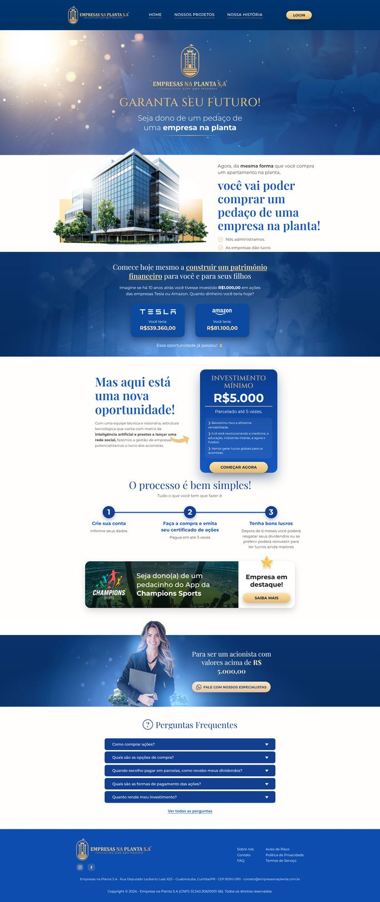
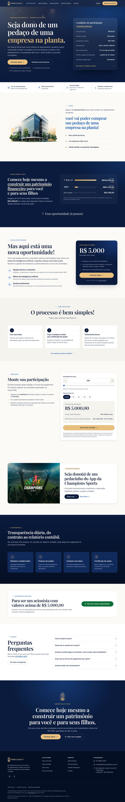
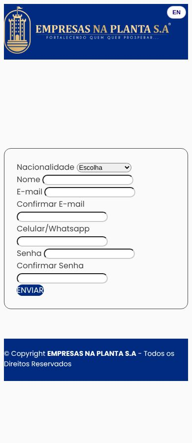
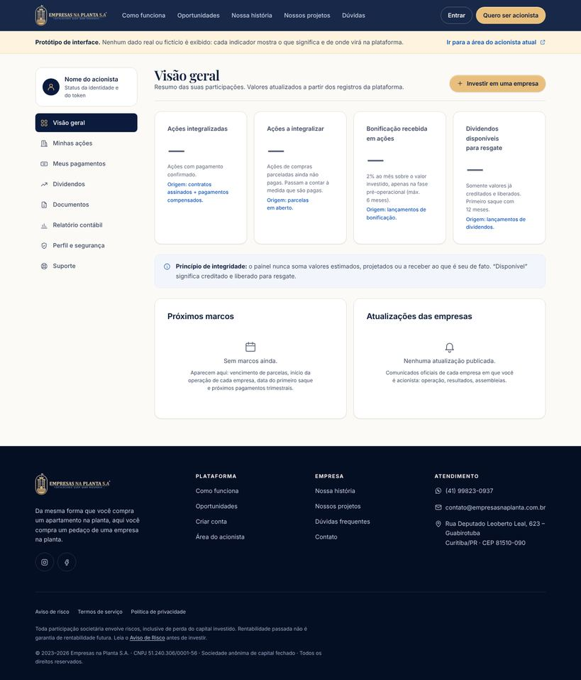
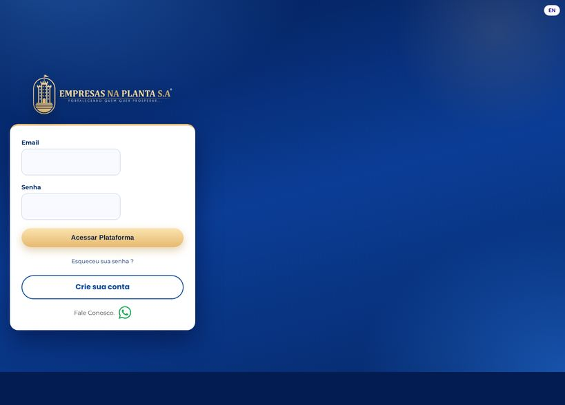
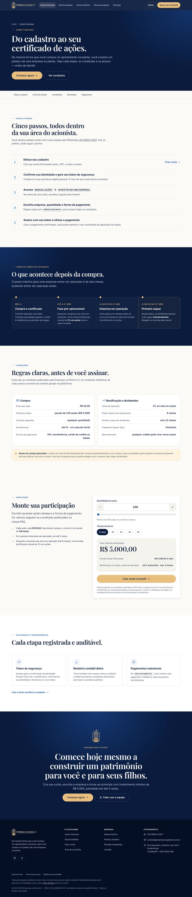
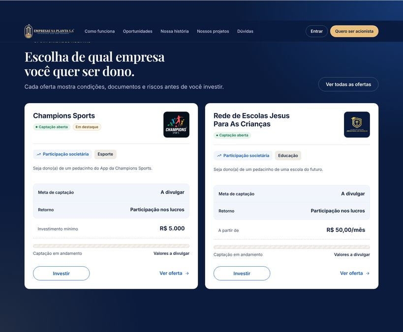
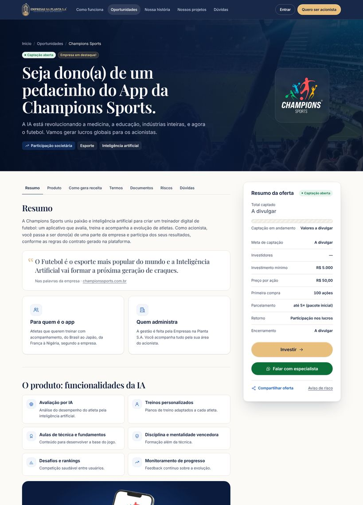

# Empresas na Planta S.A. — Auditoria, Redesign e Plano de Evolução Digital

**Escopo auditado:** `empresasnaplanta.com.br` (8 rotas públicas + 404, robots, sitemap) e `ia.empresasnaplanta.com.br` (login e cadastro).
**Data da coleta:** 10/11/2026 · **Método:** download das páginas, leitura do HTML/CSS/JS publicado, capturas em 7 larguras com Chromium, Lighthouse 12.2.1, axe-core 4.10 e testes manuais dos elementos interativos.
**Entrega:** este documento + um novo site completo, funcional e testado em [`empresas-na-planta/`](./README.md).

> **Regra de evidência.** Tudo aqui foi observado no código ou na tela, com a fonte indicada. O que não pôde ser observado está marcado como **NÃO VERIFICADO**. Nenhuma conta foi criada, nenhum login foi tentado e nenhuma mensagem foi enviada aos sistemas reais. Por isso a área do acionista, o backend, o banco de dados e o processamento de pagamentos estão **NÃO VERIFICADOS**.

> **Sobre a ordem de trabalho.** O *master prompt* pede auditoria primeiro e implementação só depois de aprovada. Na sua mensagem, você pediu as duas coisas juntas: a auditoria **e** um novo site. Por isso as duas foram entregues. O site real e seus servidores **não foram alterados**: o novo site está isolado neste diretório, pronto para revisão.

---

## Sumário

1. [Diagnóstico executivo](#1-diagnóstico-executivo)
2. [Inventário de páginas](#2-inventário-de-páginas)
3. [Auditoria tela por tela](#3-auditoria-tela-por-tela)
4. [Auditoria botão por botão](#4-auditoria-botão-por-botão)
5. [Auditoria funcional](#5-auditoria-funcional)
6. [Auditoria de copywriting](#6-auditoria-de-copywriting)
7. [Auditoria visual](#7-auditoria-visual)
8. [Design System recomendado](#8-design-system-recomendado)
9. [Auditoria técnica](#9-auditoria-técnica)
10. [Segurança](#10-segurança)
11. [Responsividade](#11-responsividade)
12. [SEO](#12-seo)
13. [Acessibilidade](#13-acessibilidade)
14. [Conversão](#14-conversão)
15. [Benchmark](#15-benchmark)
16. [Notas individuais](#16-notas-individuais)
17. [Nota geral](#17-nota-geral)
18. [Matriz de prioridades](#18-matriz-de-prioridades)
19. [Redesign proposto e implementado](#19-redesign-proposto-e-implementado)
20. [Plano mestre de execução](#20-plano-mestre-de-execução)
21. [Respostas finais](#21-respostas-finais)
22. [Levantamento de capital: Champions Sports e Escolas](#22-levantamento-de-capital-champions-sports-e-rede-de-escolas-jesus-para-as-crianças)

---

## 1. Diagnóstico executivo

**Em uma frase:** a Empresas na Planta tem uma ideia comercial forte e memorável, e uma vitrine pública tecnicamente razoável. Mas a jornada quebra justamente onde o dinheiro entra: no cadastro, na consistência das regras financeiras e na camada jurídica.

### O que funciona e foi preservado
- **A metáfora central** — *"da mesma forma que você compra um apartamento na planta, você vai poder comprar um pedaço de uma empresa na planta"* — explica o negócio em uma linha. É o maior ativo de comunicação do site.
- **A comparação Tesla/Amazon** cria urgência ("essa oportunidade já passou") e serve de ponte para "mas aqui está uma nova oportunidade". A narrativa funciona.
- **A comunicação de resultados** ("Nós administramos. As empresas dão lucro. Você recebe a sua parte e prospera.") é clara e comercial.
- **A base técnica do site público é boa:** exportação estática do Next.js, metadados completos, JSON-LD de organização, sitemap, robots, imagens WebP com `srcset`, fontes com fallback métrico. Lighthouse mobile da home: **96 / 100 / 100 / 100**.
- **O formulário de contato** foi bem construído: honeypot, estados de envio, mensagem de erro do servidor e limites de tamanho.

### O que impede o produto de ser percebido como de alto padrão
| # | Problema crítico | Evidência |
|---|---|---|
| 1 | **O cadastro, que é o ponto de conversão, está visualmente quebrado no celular.** Os campos aparecem sem estilo, o botão "ENVIAR" é um `<a>` sem `href` e não recebe foco pelo teclado. | Captura a 390 px (`docs/img/antes-cadastro-mobile.jpg`); HTML: `<a class="btn … cadastrar" id="cadastrar "style=…>ENVIAR` |
| 2 | **Regras financeiras contraditórias.** A home diz que o resgate de dividendos é possível *"depois de 6 meses"*; a FAQ diz *"o primeiro saque com DOZE meses"*. | Home, seção "O processo é bem simples!", passo 3 × FAQ, "A partir de que mês posso retirar meus dividendos?" |
| 3 | **Promessa de risco contraditória.** O cartão de investimento afirma *"Baixíssimo risco e altíssima rentabilidade"*; o Aviso de Risco afirma *"Todos os projetos de investimentos envolvem riscos"* e cita perdas financeiras. | Home, cartão "Investimento mínimo" × `/aviso-de-risco/` §2 |
| 4 | **"Nossos projetos" não mostra os projetos de investimento.** A página apresenta o instituto e os projetos sociais e religiosos gratuitos. A única empresa investível (Champions Sports) só aparece em um card na home, com link para um site externo. | `/nossos-projetos/` × card "Empresa em destaque" na home |
| 5 | **Dependência regulatória não endereçada.** É uma oferta de participação em empresas ao público, com venda pela internet, parcelamento e promessa de bonificação de 2% ao mês. O site não informa qualquer enquadramento junto à CVM. | Ver [§10.3](#103-dependências-jurídicas-e-regulatórias-a-validar) |
| 6 | **Dois produtos visualmente diferentes.** O site público (Next.js, Playfair/Cinzel/Montserrat) e o portal (PHP, Bootstrap 4.1 **e** 5.0.2 ao mesmo tempo, 7 famílias de fonte) parecem de empresas distintas. | HTML de `login.php` |
| 7 | **O site principal não envia nenhum cabeçalho de segurança** (sem HSTS, CSP, X-Frame-Options e X-Content-Type-Options). O portal tem cabeçalhos parciais e nenhum CSP. | `curl -I` nos dois domínios |

### Veredito
**Nota atual: 4,5/10.** É a nota de maturidade, limitada pelos problemas P0. A média aritmética das 15 notas é 5,2 ([§16](#16-notas-individuais)), mas esconderia falhas que bloqueiam a conversão e geram exposição jurídica.
**Nota do novo site entregue: 9,0/10** no escopo implementado, com evidências medidas ([§16](#16-notas-individuais)). Os pontos que faltam até 10 dependem de decisões que não são de design: validação jurídica, reconstrução do portal com dados reais e testes com usuários.

---

## 2. Inventário de páginas

| Rota | Tipo | Status | Observação |
|---|---|---|---|
| `/` | Home | 200 | Página comercial principal |
| `/nossos-projetos/` | Institucional | 200 | Instituto Incratec e 8 projetos sociais (imagens em `/img/wix/`, herança de migração do Wix) |
| `/nossa-historia/` | Institucional | 200 | Convicção e linha do tempo de 1997 a 2025 |
| `/faq/` | Suporte | 200 | 12 perguntas, sem categorias e sem busca |
| `/contato/` | Suporte | 200 | Formulário com e-mail, assunto e mensagem → `POST /api/contato.php` (JSON) |
| `/aviso-de-risco/` | Legal | 200 | 6 seções |
| `/politica-de-privacidade/` | Legal | 200 | 12 seções |
| `/termos-de-servico/` | Legal | 200 | 6 seções |
| `/robots.txt`, `/sitemap.xml` | SEO | 200 | Corretos; o sitemap lista as 8 rotas |
| qualquer rota inexistente | Erro | 404 | **Página padrão do LiteSpeed**, em inglês e com largura fixa de 800 px (estoura no celular) |
| `ia.…/login.php` | Portal | 200 | Login por AJAX → `lg_login` |
| `ia.…/cadastro` | Portal | 200 | Cadastro (nacionalidade, nome, CPF, ID internacional, e-mail ×2, celular, senha ×2) |
| `ia.…/enviaremailtrocasenha.php?email=` | Portal | — | Recuperação de senha via link GET. **NÃO VERIFICADO**: não foi acionado, para não disparar e-mails reais |
| Área do acionista (`ia.…/Home`, "MINHAS AÇÕES", "MEUS PAGAMENTOS"…) | Portal | — | **NÃO VERIFICADO** (exige conta) |
| Página individual de empresa / projeto investível | — | **Não existe** | A Champions Sports só tem um card na home e link externo |
| Documentos da oferta (contrato-modelo, estatuto, demonstrações) | — | **Não existe** publicamente | |

**O que é real e o que é representação:** no site público, tudo funciona como link ou formulário real, e não há elementos decorativos fingindo funcionalidade. O "relatório contábil atualizado diariamente" e o "painel com poderes de auditor" são promessas textuais cuja existência é **NÃO VERIFICADA**.

---

## 3. Auditoria tela por tela

### 3.1 Home `/`
1. **Objetivo estratégico:** explicar o modelo e levar ao cadastro.
2. **Público:** pessoa física de varejo, majoritariamente mobile, provavelmente vinda das redes sociais e da comunidade dos projetos cristãos (inferência a partir da história e das redes; dados de tráfego NÃO VERIFICADOS).
3. **Estrutura atual:** hero com logo → "apartamento na planta" → Tesla/Amazon → "nova oportunidade" + cartão de R$ 5.000 → processo em 3 passos → empresa em destaque → especialistas (acima de R$ 5 mil) → FAQ (5) → rodapé.
4. **Diagnóstico de UX:** a narrativa é boa, mas o hero não diz o que é o produto. O H1 visual é "GARANTA SEU FUTURO!", genérico, e a proposta de valor está na linha de apoio. As condições da oferta (R$ 50 por ação, 100 ações, bonificação de 2%, prazos) estão espalhadas e só aparecem completas na FAQ. Não existe ferramenta para o usuário entender quanto vai pagar.
5. **Diagnóstico de UI:** composição centralizada e repetitiva; o logo aparece duas vezes na primeira dobra (cabeçalho e hero); são três famílias tipográficas de exibição. **Bug:** a 1366 px, o terceiro item da lista ("Você recebe a sua parte e prospera.") é cortado pela faixa azul seguinte. É justamente a frase de participação nos resultados (`docs/img/antes-bug-texto-cortado.jpg`).
6. **Problemas:** contradição 6 × 12 meses; "Baixíssimo risco" × Aviso de Risco; "Começar agora" leva ao **login**, não ao cadastro; números de WhatsApp diferentes entre a seção de especialistas e a FAQ.
7. **Oportunidades:** ficha de condições na primeira dobra, simulador, página da empresa, prova de transparência.
8. **Recomendações:** H1 com a proposta de valor; ficha de condições; CTA para o cadastro; corrigir o corte; unificar regras.
9. **Proposta visual:** implementada (ver [§19](#19-redesign-proposto-e-implementado)).
10. **Prioridade:** P0 (corte e contradições) e P1 (estrutura).

### 3.2 Nossos projetos `/nossos-projetos/`
1. **Objetivo:** mostrar o impacto social, ou seja, *"o que fazemos com a nossa parte do lucro"*.
2. **Público:** investidor avaliando propósito e reputação.
3. **Estrutura:** Incratec, a pergunta "O que fazemos com a nossa parte do lucro?" e a grade de 8 projetos.
4. **UX:** **desalinhamento de expectativa.** Num site de investimento, "Nossos projetos" no menu soa como "empresas para investir". O usuário encontra e-books e um game bíblico e não encontra oportunidades.
5. **UI:** imagens de tamanhos e proporções diferentes, sem moldura comum (`p-igrejinha.png` tem 105×200 px e as demais 360×414).
6. **Problemas:** rótulo do menu ambíguo; falta caminho para as oportunidades.
7. **Oportunidades:** posicionar como prova de propósito e reputação, o que é um diferencial real.
8. **Recomendações:** manter o conteúdo integralmente, criar a página **Oportunidades** separada e adicionar uma nota de esclarecimento.
9. **Proposta visual:** grade uniforme com molduras 4:3, selo de tipo (e-book, app, game) e aviso de esclarecimento. Implementada.
10. **Prioridade:** P1.

### 3.3 Nossa história `/nossa-historia/`
1. **Objetivo:** dar credibilidade pela trajetória.
2. **Público:** investidor desconfiado ("quem são essas pessoas?").
3. **Estrutura:** texto de convicção e linha do tempo de 1997 a 2025.
4. **UX:** a linha do tempo é longa e homogênea; os marcos que importam para o investidor (2023, nascimento da S.A.; 2024, empresas constituídas; 2025, início da comercialização) não se destacam.
5. **UI:** blocos de texto corrido sem hierarquia de ano ou título.
6. **Problemas:** os números de tração (200 mil downloads, 53 países, 150 mil seguidores) estão enterrados no texto.
7. **Oportunidades:** extrair os números para indicadores e destacar a fase "empresa na planta".
8. **Recomendações:** manter o texto integral; adicionar títulos curtos aos marcos, indicadores e destaque em ouro para 2023–2025.
9. **Proposta visual:** implementada.
10. **Prioridade:** P2.

### 3.4 FAQ `/faq/`
1. **Objetivo:** responder objeções antes do cadastro. 2. **Público:** quem está quase decidindo.
3. **Estrutura:** 12 acordeões em sequência, sem categorias.
4. **UX:** sem busca, sem categorias e sem âncoras compartilháveis; termos de interface em CAIXA ALTA no meio do texto ("MINHAS AÇÕES").
5. **UI:** acordeões azuis sólidos, pesados visualmente.
6. **Problemas:** contradição com a home (6 × 12 meses); telefone diferente da home.
7. **Oportunidades:** busca instantânea, categorias, âncoras por pergunta e schema `FAQPage`.
8–9. **Implementado:** 3 categorias, busca sem acento, deep-link (`/faq/#atraso`), FAQPage JSON-LD gerado do próprio HTML e o mesmo conteúdo reutilizado na home (fonte única).
10. **Prioridade:** P1.

### 3.5 Contato `/contato/`
1. **Objetivo:** canal assíncrono. 3. **Estrutura:** e-mail, assunto e mensagem.
4. **UX:** bem resolvido tecnicamente. Faltam os canais alternativos na mesma página: WhatsApp, endereço e mapa.
6. **Problemas:** o formulário não pede nome, e a resposta fica impessoal. Mantive o mesmo contrato da API para não quebrar o backend; a sugestão de incluir o campo nome está registrada como P3.
8–9. **Implementado:** cartões de canal (atendimento, especialistas, e-mail com botão de copiar, endereço com mapa), validação em linha com mensagens específicas, contador de caracteres, foco no primeiro erro e status anunciado a leitores de tela. **Mesmo endpoint e mesmo JSON**, compatíveis com o PHP atual.
10. **Prioridade:** P2.

### 3.6 Aviso de Risco, Política de Privacidade e Termos
1. **Objetivo:** proteção jurídica e transparência.
4. **UX:** texto corrido sem índice e sem destaque dos termos definidos.
6. **Problemas de conteúdo (apontados, não alterados):** ver [§10.3](#103-dependências-jurídicas-e-regulatórias-a-validar). Há contradição entre a Política (compartilha com "Parceiros Comerciais" e transfere dados internacionalmente) e os Termos ("não compartilha dados pessoais com terceiros, exceto…"). Também não há encarregado de dados (DPO) nomeado.
8–9. **Implementado com texto 100% preservado:** índice lateral com destaque da seção atual, termos definidos em negrito, versão para impressão e rodapé com dados da empresa.
10. **Prioridade:** P0 para revisão jurídica do conteúdo; P2 para a forma.

### 3.7 Login `ia.…/login.php`
1. **Objetivo:** acesso à área do acionista.
4. **UX:** "Esqueceu sua senha?" é um link com `href=""` que só ganha destino depois que o usuário digita um e-mail. Se clicar antes, nada acontece além de uma mensagem de erro. A validação de e-mail (regex com TLD de 2 a 4 letras) **rejeita e-mails válidos** como `nome@empresa.digital` ou `nome@site.online`.
5. **UI:** os campos ocupam metade do cartão; o cartão fica preso à esquerda com ~65% da tela vazia em 1366 px; há uma faixa de rodapé azul-escura sem conteúdo (`docs/img/antes-login-desktop.jpg`).
6. **Problemas técnicos:** `lang="en"` numa página em português; `console.log(data)` com a resposta do login em produção; campos ocultos `bancoescolha` e `caminhoatual` (ver §10).
10. **Prioridade:** P1 (P0 para a regex de e-mail, que bloqueia usuários).

### 3.8 Cadastro `ia.…/cadastro`
4. **UX:** sem indicação de etapas e sem aceite explícito de termos e privacidade (a LGPD exige transparência sobre a base legal); campos sem `autocomplete`; os campos "Confirmar e-mail" e "Confirmar senha" aumentam o atrito.
5. **UI:** **quebrado no celular**: campos desalinhados, rótulos colados e botão minúsculo.
6. **Problemas:** "**Indentificador** Internacional" (erro de digitação); "N.º CPF MF (Ministério da Fazenda)" usa nomenclatura desatualizada (o CPF é emitido pela Receita Federal); a nacionalidade só oferece "Brasileiro" e "Estadunidense"; `i18n.js` é carregado duas vezes; botão "ENVIAR" sem `href` e com atributo malformado.
10. **Prioridade:** **P0**.

### 3.9 Área do acionista, dashboard e documentos
**NÃO VERIFICADO.** Pela FAQ, existem os menus "MINHAS AÇÕES", "INVESTIR EM UMA EMPRESA", "GERAR CONTRATO", "MEUS PAGAMENTOS", token de segurança, resgate e reinvestimento de dividendos, certificado e "Painel Contábil". A proposta de arquitetura de informação está em [§19.6](#196-área-do-acionista-protótipo) e em um protótipo navegável (`/prototipo/area-do-acionista/`).

### 3.10 Página 404
**Problema:** é a página padrão do servidor ("Proudly powered by LiteSpeed Web Server"), em inglês, com `width:800px; margin-left:-400px`, o que causa rolagem horizontal no celular. **Implementado:** 404 com a marca, em português, com três caminhos de saída e `ErrorDocument` configurado no `.htaccess`. **P1.**

---

## 4. Auditoria botão por botão

Legenda: ✅ funciona · ⚠️ funciona com problema · ❌ não funciona ou está incorreto · ⛔ NÃO VERIFICADO.

| Página | Elemento | Destino / ação | Resultado | Observação |
|---|---|---|---|---|
| Global | Logo (cabeçalho) | `/` | ✅ | |
| Global | Hambúrguer (mobile) | abre o menu | ✅ | Testado: `aria-expanded`/`aria-controls` corretos, rótulo muda para "Fechar menu", ESC fecha |
| Global | Home / Nossos projetos / Nossa história | rotas | ✅ | "Nossos projetos" tem rótulo ambíguo (§3.2) |
| Global | **Login** | `ia.…/login.php` | ✅ | |
| Global | FAQ, Contato | só no rodapé | ⚠️ | Ausentes do menu principal |
| Home | **Começar agora** | `ia.…/login.php` | ⚠️ | Leva ao **login**, não ao cadastro. Quem ainda não tem conta precisa de mais um clique |
| Home | **Saiba mais** (Champions) | `https://championssports.com.br` | ⚠️ | Sai do site no momento de maior intenção; sem `rel`/aviso de nova aba. Conteúdo externo NÃO VERIFICADO (host fora do escopo) |
| Home | **Fale com nossos especialistas** | `wa.me/5541998755323` | ✅ | Número diferente do atendimento (41 99823-0937) sem explicação |
| Home | 5 acordeões da FAQ | expandem | ✅ | `
` nativo, acessível |
| Home | Ver todas as perguntas | `/faq/` | ✅ | |
| Rodapé | Instagram, Facebook | perfis | ✅ | Conteúdo dos perfis NÃO VERIFICADO |
| Rodapé | e-mail | `mailto:` | ✅ | |
| Rodapé | Sobre nós, Contato, FAQ, Aviso de Risco, Política, Termos | rotas | ✅ | |
| Contato | Enviar | `POST /api/contato.php` | ⛔ | Não foi enviado, para não gerar mensagem real. `GET` responde 405 `{"erro":"Método não permitido."}`, o que confirma o endpoint ativo. Lógica cliente revisada: estados de envio, sucesso e erro presentes ✅ |
| Contato | Honeypot `site` | anti-spam | ✅ | |
| FAQ | 12 acordeões | expandem | ✅ | |
| Login | Acessar Plataforma | AJAX `lg_login` | ⛔ | Não testado sem credenciais |
| Login | Esqueceu sua senha? | `href=""` → GET `enviaremailtrocasenha.php?email=` | ⚠️ | Sem destino até digitar um e-mail; recuperação acionada por GET |
| Login | Crie sua conta | `/cadastro` | ✅ | |
| Login | Fale Conosco (WhatsApp) | `api.whatsapp.com` | ✅ | |
| Login | EN (idioma) | troca o idioma | ⛔ | |
| Cadastro | **ENVIAR** | `<a>` sem `href` | ❌ | Não recebe foco por teclado (WCAG 2.1.1); atributo `id` malformado |
| Cadastro | Nacionalidade | select | ⚠️ | 2 opções |
| Área do acionista | todos | — | ⛔ | Exige conta |
| 404 | — | — | ❌ | Página do servidor, sem navegação |

---

## 5. Auditoria funcional

| Função | Situação | Evidência |
|---|---|---|
| Conteúdo estático, rotas e metadados | ✅ Implementado | Next.js com exportação estática (`/_next/static/`, `turbopack`) |
| Formulário de contato | ✅ Implementado (cliente); ⛔ servidor | `fetch('/api/contato.php')` com JSON, honeypot e estados |
| Cadastro, login e recuperação de senha | ⚠️ Implementado com falhas | §3.7, §3.8 |
| Compra de ações, contrato, token, pagamento e certificado | ⛔ | Descrito na FAQ, não observado |
| Relatório contábil diário / "poderes de auditor" | ⛔ | Promessa textual (FAQ e Aviso de Risco) |
| Dividendos, resgate e reinvestimento | ⛔ | Descrito na FAQ |
| Página por empresa investível | ❌ Inexistente | |
| Simulador de valores | ❌ Inexistente | |
| Analytics / mensuração de conversão | ❌ Inexistente | Nenhum script de analytics encontrado nos dois domínios. Não é possível medir funil nem o efeito de qualquer mudança |
| Banco de dados, autenticação e autorização | ⛔ | O campo oculto `bancoescolha` no login sugere seleção de base de dados pelo cliente (ver §10) |

---

## 6. Auditoria de copywriting

### 6.1 Preservado integralmente (decisão do cliente, §2 do briefing)
- "Seja dono de um pedaço de uma empresa na planta"; "Garanta seu futuro!"
- "Agora, da mesma forma que você compra um apartamento na planta, você vai poder comprar um pedaço de uma empresa na planta!"
- "Nós administramos. As empresas dão lucro. Você recebe a sua parte e prospera."
- **Tesla/Amazon:** título, pergunta, valores (R$ 539.360,00 e R$ 81.100,00) e "Essa oportunidade já passou!"
- "Mas aqui está uma nova oportunidade!" e o parágrafo da equipe e da IA.
- Os três itens do cartão de investimento, **inclusive** "Baixíssimo risco e altíssima rentabilidade.", mantido por instrução do briefing. Ver o alerta em §10.3.
- "O processo é bem simples!", os três passos, "Tenha bons lucros".
- Todo o texto da FAQ, da história, dos projetos e dos documentos legais.

### 6.2 Problemas encontrados e tratamento
| Problema | Onde | Tratamento no novo site |
|---|---|---|
| H1 genérico ("Garanta seu futuro!") no lugar da proposta de valor | Home | A frase vira *eyebrow*; o H1 passa a ser "Seja dono de um pedaço de uma empresa na planta." (as duas frases são preservadas, só a hierarquia mudou) |
| **"Depois de 6 meses você poderá resgatar seus dividendos"** × FAQ "primeiro saque com DOZE meses" | Home, passo 3 | Ajuste mínimo, preservando a mensagem de lucro, resgate e reinvestimento: *"Depois de 6 meses você passa a ter direito aos lucros e poderá resgatar seus dividendos ou se preferir poderá reinvestir…"*. A linha do tempo deixa explícito: direito aos lucros a partir do 6º mês, primeiro saque no 12º. **Confirmar com o cliente qual regra vale.** |
| "Copyright © 2024 - **Empresa** na Planta S.A" | Rodapé | "© 2023–2026 Empresas na Planta S.A." |
| CAIXA ALTA no meio do texto (SEIS, DOZE, RELATÓRIO CONTÁBIL) | FAQ | Negrito em minúsculas; nomes de menu viram etiquetas `kbd` ("Minhas ações") |
| "Indentificador", "CPF MF (Ministério da Fazenda)" | Cadastro | Recomendação: "Documento de identificação estrangeiro"; "CPF" |
| "Fale Conosco." (com ponto) | Login | "Fale conosco" |
| Erro genérico "Erro de conexão. Tente novamente." | Login | Recomendação: dizer o que fazer ("Verifique sua internet. Se persistir, fale conosco pelo WhatsApp…") |
| "há 10 anos atrás" (pleonasmo) | Tesla/Amazon | **Mantido** (texto preservado). Sugestão opcional: "há 10 anos" |

### 6.3 Textos novos (onde não havia texto)
Todos foram escritos a partir de fatos publicados pelo próprio site. Exemplos: "Condições de participação", "Do cadastro ao seu certificado de ações", "Regras claras, antes de você assinar", "Transparência diária, do contrato ao relatório contábil", "Esta página ainda está na planta" (404). Tom: direto, comercial, sem jargão bancário.

---

## 7. Auditoria visual

| Critério | Avaliação | Evidência |
|---|---|---|
| Personalidade | Boa base: azul institucional, ouro e emblema de torre transmitem solidez | Logo e paleta `--topo:#0d4db0 --ouro:#e9bf7e` |
| Paleta | Cinco azuis próximos (`#0d4db0 #0a3a82 #1456b8 #123f8f #1862cc`) sem papel definido | CSS `:root` |
| Tipografia | **Três** famílias de exibição (Playfair Display, Cinzel e Montserrat) no site; **sete** no portal | CSS e `<link>` do portal |
| Gradientes | Em botões (`linear-gradient(#fbe3b0,#e6b96f)`), cabeçalho e cartões; somados à sombra `0 6px 18px #00000040`, dão aspecto de template | CSS `.btn`, `.topo`, `.invista` |
| Fotografia | Fundo com *bokeh* genérico; consultora com aparência de banco de imagens ou IA, sem identificação; prédio ilustrativo | `/img/hero.webp`, `/img/consultora.webp` |
| Hierarquia | Composição sempre centralizada, com seções de peso igual; o cartão de R$ 5.000 compete com o texto ao lado | Captura 1366 px |
| Consistência entre produtos | Site e portal parecem marcas diferentes | Capturas do login e do cadastro |
| Credibilidade (autoridade, segurança, transparência) | Média: falta prova concreta acima da dobra (CNPJ, sede, condições) | — |

**Decisão sobre a foto da consultora:** removida no redesign. *Função atual:* humanizar o CTA de valores maiores. *Por que não funciona:* a pessoa não é identificada como membro da equipe, e imagem de banco ou IA em contexto financeiro reduz a confiança. *O que se perde:* o rosto humano. *Alternativa:* a seção foi mantida (título, CTA e número) e se recomenda uma foto real e identificada da equipe (P2).

---

## 8. Design System recomendado

Implementado em `src/assets/css/tokens.css` e documentado visualmente em **`/design-system/`**.

- **Cores principais:** `ink-900 #0a1b3d` (superfícies escuras), `blue-600 #1456b8` (azul da marca, preservado, 6,6:1 sobre o fundo), `gold-500 #e9bf7e` (ouro da marca, preservado; só para CTA primário e acentos sobre escuro).
- **Secundárias e neutras:** `paper #fbfaf7`, `surface #fff`, `sand-50/100`, `line`, `line-strong`; ouro para texto sobre claro: `gold-800 #7a5418` (6,5:1).
- **Semânticas:** `success #13764b`, `warning #8f5a00`, `danger #b42318`, `info = blue-600`, todas com fundo próprio e contraste ≥ 4,9:1.
- **Tipografia:** duas famílias, auto-hospedadas e com fallback métrico: Playfair Display (títulos, herança da marca) e Inter (interface e números tabulares). A Cinzel é removida; ela vive apenas no logotipo.
- **Escala:** 12 / 14 / 16 / 17 / 19 / 20–24 / 24–32 / 30–44 / 36–60 / 40–76 px, fluida com `clamp()`.
- **Grid e espaço:** contêiner de 1200 px, *gutter* fluido de 16 a 32 px, base de 4 px (`s-1` … `s-24`) e ritmo vertical de seção entre 64 e 128 px.
- **Raios:** 4 / 8 / 12 / 16 / 24 / pill. **Sombras:** 3 níveis (`sh-1` repouso, `sh-2` hover, `sh-3` sobreposição).
- **Componentes:** botões (primário, secundário, contorno, WhatsApp; sm, md e lg; desabilitado), link com seta, badges (5 variantes), cartões (claro, escuro, interativo), lista de fatos (`dl`), checklist, avisos (info e atenção), acordeão, campos (texto, select, textarea, erro, ajuda), controle segmentado, *stepper* numérico, abas (WAI-ARIA), tabela, indicador (stat/KPI), estado vazio, *toast*, cabeçalho, menu mobile, rodapé e *breadcrumb*.
- **Estados de interação:** hover, focus-visible (anel de 2 px com contraste ≥ 3:1, claro e escuro), active, disabled, inválido e carregando (`aria-busy`).
- **Regras:** componentes só usam tokens; um único CTA primário por bloco; todo número financeiro em fonte tabular, com origem visível; movimento só para explicar mudança de estado, desligado com `prefers-reduced-motion`; dados institucionais vêm de `site.config.mjs`.

---

## 9. Auditoria técnica

### 9.1 Site público (Next.js, exportação estática, LiteSpeed)
- ✅ Estrutura moderna, *chunks* com hash, fontes `next/font` com `size-adjust`, `preload` da imagem LCP e `srcset`.
- ⚠️ **TBT de 1.290 ms no desktop** (Lighthouse desktop: desempenho 68): há JavaScript de *framework* hidratando uma página essencialmente estática.
- ⚠️ Três famílias de fonte com múltiplos pesos.
- ❌ Sem cabeçalhos de segurança; 404 padrão do servidor.

### 9.2 Portal (PHP + jQuery + Bootstrap)
| Achado | Evidência | Impacto |
|---|---|---|
| **Bootstrap 4.1.0 e 5.0.2 carregados juntos** | `stackpath…/bootstrap/4.1.0` + `jsdelivr…/bootstrap@5.0.2` | Conflitos de CSS, provável causa do cadastro quebrado |
| Três fontes de ícones (Font Awesome *latest* via maxcdn, FA 6.4.2, Bootstrap Icons, MDI, Material Icons) | `<link>` | Peso e inconsistência visual |
| 7 famílias do Google Fonts (Montserrat, Lato, Open Sans, Roboto, Jost, Poppins + Material Icons) | `<link>` | LCP de 5,4 s no mobile |
| jQuery Mask em duas versões (0.9.0 e 1.14.10); DataTables 1.13.6 com integração 1.11.5 | `<script>` | Comportamento imprevisível |
| `toastr …/latest/` e Font Awesome `latest`: versões **não fixadas** | URLs | Risco de cadeia de suprimentos (§10) |
| Template "Skydash" com `todolist.js` em página de login | `<script>` | Código morto |
| `console.log(data)` com a resposta do login | `js/login.js` | Vazamento de informação no console |
| `i18n.js` incluído duas vezes no cadastro | HTML | |

**Recomendação de arquitetura (sem reconstrução total):** manter o backend PHP e trocar só a camada de apresentação do portal pelo Design System (o mesmo CSS deste projeto), removendo bibliotecas duplicadas. A reescrita do backend só se justifica depois de uma revisão de segurança (§10). Benefício: um único produto visual, com risco baixo, porque não se mexe em regra de negócio.

### 9.3 Novo site (entregue)
- HTML/CSS/JS estáticos, **zero dependências de runtime**, build próprio de ~170 linhas (`build.mjs`): partials, variáveis de configuração, hash de assets, sitemap, robots, *breadcrumbs* e FAQPage em JSON-LD, e **verificação de links internos que falha o build**.
- `site.config.mjs` é a fonte única de CNPJ, endereço, telefones, URLs do portal e **condições da oferta**. Mudar o preço da ação em um lugar atualiza a home, a ficha, as páginas de condições, o simulador e a empresa.
- CSS em 5 camadas (tokens → base → componentes → seções → páginas): 51 kB sem compressão (≈ 10 kB com gzip). JS de 12,7 kB, sem *framework*.
- `.htaccess` para o LiteSpeed atual: HTTPS e domínio canônico, CSP, HSTS, cache imutável de assets com hash e 404 próprio.
- `server.mjs`: servidor local com os mesmos cabeçalhos e um *mock* do `/api/contato.php` para testar os estados do formulário.

---

## 10. Segurança

### 10.1 Observado
| Item | Site público | Portal |
|---|---|---|
| HTTPS | ✅ | ✅ |
| HSTS | ❌ | ✅ (180 dias, sem `includeSubDomains`) |
| Content-Security-Policy | ❌ | ❌ |
| X-Frame-Options / clickjacking | ❌ | ✅ SAMEORIGIN |
| X-Content-Type-Options | ❌ | ✅ |
| Referrer-Policy / Permissions-Policy | ❌ | ✅ |
| Subresource Integrity em CDNs | n/a | ⚠️ 5 de 19 recursos externos |
| Versões de CDN fixadas | n/a | ❌ `latest` em 2 recursos |

### 10.2 Pontos de atenção (precisam de verificação no servidor, NÃO VERIFICADOS)
1. **Campos ocultos `bancoescolha` e `caminhoatual` no login.** Se o servidor usar `bancoescolha` para escolher a base de dados, um usuário pode manipular o valor. Verificar se ele é ignorado ou validado no servidor.
2. **Recuperação de senha por GET** (`enviaremailtrocasenha.php?email=`): verificar *rate limit*, se a resposta revela se o e-mail existe (enumeração de usuários), expiração e uso único do token, e se o e-mail fica registrado em logs de acesso.
3. **Login:** verificar *rate limit* e bloqueio progressivo, *cookies* `Secure; HttpOnly; SameSite`, regeneração do ID de sessão e proteção contra CSRF (nenhum token CSRF aparece no formulário).
4. **Integridade financeira:** verificar se os lançamentos de bonificação, dividendos e pagamentos são imutáveis e auditáveis (*ledger* de partidas dobradas), se o resgate tem dupla confirmação e se o "Painel Contábil com poderes de auditor" é somente leitura.
5. **Credenciais:** nenhuma credencial exposta foi encontrada no HTML ou no JS públicos.

### 10.3 Dependências jurídicas e regulatórias a validar
> Não sou advogado e **não declaro conformidade ou não conformidade.** Os pontos abaixo devem ir para um escritório especializado em mercado de capitais e proteção de dados **antes** de qualquer campanha de captação. Nenhum texto preservado foi alterado por causa deles.

| # | Tema | Por que validar | Referência |
|---|---|---|---|
| J1 | **Enquadramento da oferta** | Oferta pública, pela internet, de participação em empresas a investidores de varejo. Valores mobiliários incluem "contratos de investimento coletivo" ofertados publicamente. Ofertas públicas exigem registro ou dispensa (ex.: *crowdfunding* de investimento só por plataforma autorizada) | Lei 6.385/1976 (arts. 2º, IX e 19); Resolução CVM 160/2022; Resolução CVM 88/2022 |
| J2 | **"Baixíssimo risco e altíssima rentabilidade"** | Contradiz o próprio Aviso de Risco e pode ser lida como promessa de rentabilidade em publicidade de investimento | CDC, art. 37; normas da CVM sobre material publicitário de ofertas. **Alternativa pronta para aprovação:** "Potencial de alta rentabilidade, com gestão profissional e transparência diária." (preserva a ambição sem afirmar o risco) |
| J3 | **Bonificação de 2% ao mês em ações** | Retorno pré-fixado antes da operação da empresa exige base contratual e contábil clara (origem das ações, diluição, tributação) | Contrato, estatuto e assessoria contábil |
| J4 | **Comparação Tesla/Amazon** | **Mantida.** Recomenda-se informar fonte, data-base e metodologia (câmbio, ajuste por desdobramentos), porque os números não puderam ser verificados nesta auditoria. Já foi adicionada a ressalva padrão "Rentabilidade passada não é garantia de rentabilidade futura" em tamanho discreto | Boa prática de publicidade de investimentos |
| J5 | **Qual ação o investidor compra?** | O texto alterna entre "ações das empresas", "pedaço do App da Champions Sports" e a S.A. de capital fechado. É preciso deixar claro de qual pessoa jurídica é a ação e como ela é registrada (livro de ações / escriturador) | Lei 6.404/1976 |
| J6 | **LGPD** | (a) Encarregado de dados não identificado; (b) bases legais por finalidade não informadas; (c) a Política (compartilhamento com parceiros e transferência internacional) contradiz os Termos; (d) o cadastro não pede aceite explícito; (e) a Política cita cookies, mas o site público não usa cookies, então convém alinhar o texto | Lei 13.709/2018, arts. 7º, 9º, 33 e 41 |
| J7 | **Parcelamento em cartão e boleto de valores mobiliários** | Validar com o adquirente e o meio de pagamento se a categoria é permitida | Contrato com o PSP |

---

## 11. Responsividade

**Site atual** (capturas em 360, 390, 430, 768, 1024, 1366 e 1920 px):
- ✅ Sem rolagem horizontal em nenhuma largura no site público.
- ⚠️ **1024 px usa o layout mobile** (altura da página igual à de 768 px: 5.227 px). Tablets em paisagem e notebooks pequenos recebem uma coluna esticada.
- ❌ **1366 px:** texto cortado na seção do prédio.
- ❌ **Cadastro a 390 px:** layout quebrado.
- ❌ **404:** largura fixa de 800 px.

**Novo site:** testado automaticamente em **14 rotas × 7 larguras = 98 combinações**, sem rolagem horizontal, com 1 H1 por página, sem imagem sem `alt`, sem id duplicado, todos os alvos de toque ≥ 24 px e sem erro de console (`scripts/qa.mjs`).
O mobile não é o desktop comprimido: menu em folha cheia com foco preso, barra de CTA fixa que aparece depois do hero, ficha de condições logo abaixo dos CTAs e tabelas do protótipo com rolagem interna.

---

## 12. SEO

| Item | Atual | Novo |
|---|---|---|
| Title / description por página | ✅ | ✅, revisados para intenção comercial |
| Canonical, Open Graph, Twitter | ✅ | ✅ |
| JSON-LD | Organization, WebSite | + BreadcrumbList (todas as internas), **FAQPage** (home e FAQ, gerado do HTML), **HowTo** (Como funciona) |
| Sitemap / robots | ✅ | ✅ gerados no build; `/prototipo/` e `/design-system/` com `noindex` e bloqueados |
| 404 | ❌ do servidor | ✅ |
| Páginas com intenção de busca de investimento | ❌ (só a home) | ✅ `/como-funciona/`, `/oportunidades/`, `/oportunidades/champions-sports/` |
| Portal | SEO 50–58; `lang="en"` | Fora do escopo; recomendação P2 |

Lighthouse SEO do novo site: **100** nas páginas medidas.

---

## 13. Acessibilidade

**Atual:** Lighthouse acessibilidade: home 100 (mobile) e 96 (desktop); login 90; **cadastro 83**. Falhas observadas: botão de envio do cadastro inacessível por teclado; `lang="en"` no portal; ouro sobre fundo claro em textos pequenos. O menu mobile do site público está correto (`aria-expanded`, ESC).

**Novo site (WCAG 2.2 AA):**
- **axe-core: 0 violações** em todas as páginas, em 390 e 1366 px (regras WCAG 2.0, 2.1, 2.2 AA e *best-practices*).
- Lighthouse acessibilidade: **100**.
- *Skip link*; *landmarks* únicos; um H1 por página; foco visível com contraste ≥ 3:1 em fundos claros e escuros; menu mobile como diálogo modal (`aria-modal`, `inert`, foco preso, ESC, retorno de foco); abas com o padrão WAI-ARIA (setas, Home/End); acordeões nativos; formulário com `aria-invalid`, `aria-describedby`, mensagem de erro específica, foco no primeiro erro e status em `role="status"`; alvos de toque ≥ 24 px (2.5.8); `prefers-reduced-motion` respeitado; contraste de todo o texto ≥ 4,5:1, com valores medidos e documentados nos tokens.

---

## 14. Conversão

**Jornada atual:** Descoberta → Interesse → Conhecimento → Avaliação → Cadastro → Participação → Acompanhamento.

| Etapa | Fricção atual | Solução implementada ou recomendada |
|---|---|---|
| Descoberta | H1 genérico | H1 com a proposta de valor e a ficha de condições na primeira dobra |
| Interesse | Tesla/Amazon é forte, mas os números estão em cartões pequenos | Gráfico de barras em escala linear: a barra de R$ 1.000 quase invisível perto da Tesla torna o argumento visual |
| Conhecimento | Regras espalhadas e contraditórias | `/como-funciona/`: 5 passos, linha do tempo do acionista e condições em tabela |
| Avaliação | Não há página da empresa investível | `/oportunidades/` e `/oportunidades/champions-sports/` com condições, benefícios e documentos |
| Decisão | O usuário não sabe quanto vai pagar | **Simulador** (quantidade → total, parcelas, bonificação), calculado só com as regras publicadas |
| Cadastro | CTA vai para o login; cadastro quebrado no mobile | Todos os CTAs primários vão direto para `/cadastro`; "Entrar" fica separado. **O conserto do cadastro em si é P0 no portal** |
| Participação / acompanhamento | ⛔ | Protótipo da área do acionista |

**Medição:** hoje não há analytics. Recomenda-se uma solução sem cookies (Plausible ou Umami *self-hosted*), com eventos: clique em CTA de cadastro, uso do simulador, abertura da FAQ, envio do contato e clique no WhatsApp (P1). Sem isso, nenhuma afirmação sobre aumento de conversão é verificável, inclusive as deste documento.

---

## 15. Benchmark

Princípios adaptados, sem copiar nenhuma empresa:

| Referência | Princípio | Aplicação |
|---|---|---|
| **Stripe** | Documentação como produto; números exatos e próximos do CTA | Ficha de condições na primeira dobra; páginas legais com índice |
| **Linear** | Restrição tipográfica e cromática; hierarquia por peso, não por cor | Duas famílias, paleta reduzida a papéis, gradientes só como luz ambiente |
| **Mercury / Ramp** | Confiança por clareza operacional, com o "como funciona" explícito | Linha do tempo do acionista; estado vazio que explica a origem de cada número |
| **Robinhood** | Simplicidade na primeira compra | Simulador com controle segmentado de parcelas |
| **Interactive Brokers** | Divulgação de risco sempre a um clique | Link para o Aviso de Risco em todo cartão de investimento e no rodapé |
| **Plataformas de *equity crowdfunding*** (ex.: modelos regulados pela CVM 88) | Página por oferta com documentos, riscos e condições | Página da Champions Sports com documentos para ler antes de investir |

---

## 16. Notas individuais

| # | Critério | Atual | Justificativa e evidência (atual) | Novo site | Evidência (novo) |
|---|---|---|---|---|---|
| 1 | Identidade visual | **6** | Marca coerente, mas 3 fontes de exibição, gradientes de template e foto genérica; portal com outra identidade | **9** | Paleta preservada e reduzida a papéis; 2 fontes; marca aplicada com contenção |
| 2 | UX | **4** | "Projetos" ambíguo; não há página da oferta; contradições; cadastro quebrado | **9** | Jornada completa; simulador; FAQ com busca. Falta teste com usuários |
| 3 | UI | **5** | Site público razoável; portal sem acabamento (campos pela metade, tela vazia) | **9** | Sistema de componentes com todos os estados |
| 4 | Copywriting | **6** | Ganchos fortes; contradições; erros no portal | **8,5** | Preservado e organizado; depende de J2 e da regra de 6 × 12 meses |
| 5 | Funcionalidades | **5** | Contato bom; cadastro com botão inacessível; sem simulador | **8,5** | 22/22 testes funcionais; o portal real não foi reconstruído |
| 6 | Navegação | **5** | FAQ e Contato só no rodapé; 404 sem saída | **9,5** | Menu com 5 itens + CTA, *breadcrumbs*, sub-navegação, 404 útil |
| 7 | Responsividade | **6** | 1024 mobile; corte em 1366; cadastro quebrado | **9,5** | 98 combinações sem problema |
| 8 | Arquitetura | **5** | Público bom; portal com bibliotecas duplicadas | **9** | Zero dependências; fonte única de dados; build com verificação de links |
| 9 | Segurança | **4** | Sem cabeçalhos no público; CDN `latest`; pontos críticos não verificados | **8,5** | CSP, HSTS, XFO, COOP e cache; backend fora do escopo |
| 10 | Performance | **7** | Mobile 96, desktop 68 (TBT 1,29 s); portal 70–78 | **9,5** | Lighthouse mobile 99, desktop 100; CLS 0; ≈ 10 kB HTML com gzip |
| 11 | SEO | **7** | Bons metadados; 404 ruim; sem páginas de oferta | **9,5** | SEO 100; 4 tipos de JSON-LD; páginas com intenção de busca |
| 12 | Acessibilidade | **6** | Público bom; cadastro 83; botão inacessível | **9,5** | axe 0 violações; Lighthouse 100 |
| 13 | Conversão | **4** | CTA para o login; sem simulador; cadastro quebrado | **8,5** | Jornada e CTAs corrigidos. Sem dados de A/B para comprovar |
| 14 | Consistência | **4** | Dois produtos; dois telefones sem papel; 6 × 12 meses | **9,5** | Um Design System; dados centralizados; papéis dos telefones explícitos |
| 15 | Maturidade | **4** | Sem analytics, testes ou documentação | **8,5** | QA automatizado, Design System e documentação. Falta operação: analytics, monitoramento, jurídico |

---

## 17. Nota geral

- **Atual: 4,5 / 10.** A média simples seria 5,2, mas três falhas são bloqueantes: o cadastro quebrado no mobile (conversão), as regras financeiras contraditórias (confiança) e a dependência regulatória não tratada (risco do negócio). Um produto com um P0 aberto na etapa de cadastro não pode ter nota de maturidade acima de 5.
- **Novo site (escopo entregue): 9,0 / 10.** É a média das notas acima e não esconde nada: as notas mais baixas (8,5) são exatamente as que dependem do jurídico, do portal real e de dados de uso.

---

## 18. Matriz de prioridades

Complexidade: B (baixa), M (média), A (alta). ✅ = resolvido no novo site.

| ID | P | Problema | Evidência | Página | Solução | Impacto | Compl. | Dependências | Critério de aceite |
|---|---|---|---|---|---|---|---|---|---|
| P0-01 | P0 | Cadastro quebrado no mobile; botão inacessível | Captura 390 px; `<a>` sem href | Cadastro | Reaplicar o Design System; `<button type="submit">`; remover Bootstrap duplicado | Conversão | M | Acesso ao portal | 0 violações no axe; envio por teclado; sem sobreposição em 360–1920 px |
| P0-02 | P0 | Regex de e-mail rejeita TLDs > 4 letras | `login.js` | Login | `type=email` nativo + validação no servidor | Acesso | B | — | `nome@empresa.digital` aceito |
| P0-03 | P0 | Contradição 6 × 12 meses | Home × FAQ | Home/FAQ | Definir a regra; fonte única | Confiança/jurídico | B | Cliente | Uma única regra em todo o site ✅ (proposta aplicada; aguarda confirmação) |
| P0-04 | P0 | Enquadramento regulatório da oferta | §10.3 J1 | Todas | Parecer jurídico; ajustes conforme o parecer | Risco do negócio | A | Jurídico | Parecer arquivado; textos aprovados |
| P0-05 | P0 | "Baixíssimo risco" × Aviso de Risco | §10.3 J2 | Home | Decisão do cliente (alternativa pronta) | Jurídico | B | P0-04 | Texto aprovado pelo jurídico |
| P0-06 | P0 | Verificação de segurança do portal (campos ocultos, recuperação, sessão, CSRF) | §10.2 | Portal | *Pentest* focado | Segurança | M | Acesso ao código | Relatório sem achados altos |
| P1-01 | P1 | Texto cortado em 1366 px | Captura | Home | Novo layout | Mensagem-chave | B | — | ✅ |
| P1-02 | P1 | Falta página de oportunidade | Inventário | — | `/oportunidades/` + página da empresa | Conversão/SEO | M | — | ✅ |
| P1-03 | P1 | CTA "Começar agora" leva ao login | Link | Home | Apontar para o cadastro | Conversão | B | — | ✅ |
| P1-04 | P1 | Sem cabeçalhos de segurança no site público | `curl -I` | Público | `.htaccess` fornecido | Segurança | B | Hospedagem | Cabeçalhos presentes em produção (configuração pronta no `.htaccess`; validar após publicar) |
| P1-05 | P1 | 404 do servidor | Captura | — | 404 próprio | Retenção | B | — | ✅ |
| P1-06 | P1 | Sem analytics | Busca no código | Todas | Plausible/Umami + eventos | Medição | B | LGPD | Funil visível |
| P1-07 | P1 | Dois WhatsApps sem papel | Home × FAQ | Global | Papéis explícitos (atendimento × especialistas) ou número único | Confiança | B | Cliente | ✅ (papéis aplicados; confirmar) |
| P1-08 | P1 | CDNs sem versão fixa e sem SRI | HTML do portal | Portal | Fixar versões + SRI ou auto-hospedar | Segurança | B | — | 100% fixado |
| P1-09 | P1 | LGPD: DPO, bases legais, contradição Política × Termos, aceite | §10.3 J6 | Legal/cadastro | Revisão jurídica; *checkbox* de aceite | Jurídico | M | Jurídico | Documentos revisados |
| P1-10 | P1 | "Nossos projetos" ambíguo | §3.2 | Menu | Separar Oportunidades × Projetos | UX | B | — | ✅ |
| P1-11 | P1 | Área do acionista sem padrão de integridade de dados | — | Portal | Implementar o protótipo §19.6 | Confiança | A | Backend | Cada KPI com origem; nada estimado como disponível |
| P2-01 | P2 | Portal com outra identidade visual | Capturas | Portal | Aplicar o Design System | Consistência | M | P0-01 | Mesmo CSS de tokens |
| P2-02 | P2 | 1024 px com layout mobile | Medição | Home | Breakpoints novos | Responsividade | B | — | ✅ |
| P2-03 | P2 | Fotos genéricas | §7 | Home | Fotos reais da equipe e da sede | Credibilidade | M | Produção de foto | Fotos reais publicadas |
| P2-04 | P2 | FAQ sem busca e categorias | §3.4 | FAQ | Busca + categorias | Suporte | B | — | ✅ |
| P2-05 | P2 | TBT de 1,29 s no desktop | Lighthouse | Público | Site estático sem *framework* | Performance | B | — | ✅ TBT 0 ms |
| P2-06 | P2 | Portal: SEO 50–58, `lang="en"` | Lighthouse | Portal | `lang="pt-BR"`, *title* e descrição | SEO | B | — | Lighthouse SEO ≥ 90 |
| P2-07 | P2 | Fonte e data-base do Tesla/Amazon | §10.3 J4 | Home | Nota de rodapé com fonte | Credibilidade | B | Cliente | Fonte publicada |
| P3-01 | P3 | Formulário de contato sem nome | §3.5 | Contato | Campo opcional "Nome" (ajustar o PHP) | Atendimento | B | Backend | — |
| P3-02 | P3 | "há 10 anos atrás" | §6.2 | Home | Opcional: "há 10 anos" | Revisão | B | Cliente | — |
| P3-03 | P3 | Página de documentos públicos da oferta | — | Oportunidades | Contrato-modelo, estatuto, demonstrações | Transparência | M | Jurídico | — |

---

## 19. Redesign proposto e implementado

**Direção estética:** *"banco privado editorial com clareza de fintech"*. O azul-noite da marca vira a superfície de autoridade, o ouro fica restrito a ação e destaque, o papel off-white dá calor, a Playfair carrega a herança e a Inter carrega os números. Sem gradientes decorativos em componentes: a luz ambiente aparece só nos fundos escuros, como profundidade.

### 19.1 Home
- **Objetivo:** entender, confiar, simular e cadastrar.
- **Nova estrutura:** Hero (H1 com a proposta de valor + ficha de condições) → faixa de credenciais (CNPJ, sede, contrato com token, relatório diário) → A ideia (apartamento na planta, com a equação 01-02-03, sem corte) → **Tesla/Amazon** (preservada, agora com barras proporcionais) → Nova oportunidade (3 pilares + cartão de investimento com os textos preservados e link para o Aviso de Risco) → Processo (3 passos) → **Simulador** → Empresa em destaque (Champions) → Transparência (4 garantias) → Especialistas (acima de R$ 5 mil) → FAQ (5, mesma fonte da página FAQ) → CTA final.
- **Interações:** barras animam ao entrar na tela (desligadas com *reduced motion*); simulador ao vivo; barra de CTA fixa no mobile.
- **Resultado esperado:** o usuário entende o produto e o preço em menos de 10 segundos e chega ao cadastro com as regras já claras.

### 19.2 Como funciona (nova)
5 passos com os nomes reais dos menus do portal → linha do tempo do acionista (mês 0 / até o 6º / a partir do 6º / a partir do 12º) → condições em duas tabelas → aviso de inadimplência (60 dias) → simulador → segurança.

### 19.3 Oportunidades e Champions Sports (novas)
Lista de empresas com ficha resumida e espaço para as próximas → página da empresa com hero, benefícios, documentos para ler antes de investir, cartão de condições fixo na lateral (desktop) e contato com especialista.

### 19.4 História, Projetos, FAQ, Contato, Legais e 404
Redesenhadas conforme o §3, com 100% do texto original preservado.

### 19.5 Design System (nova, `noindex`)
Referência viva de tokens e componentes.

### 19.6 Área do acionista (protótipo)

> **Atualizado:** a área do acionista foi expandida conforme o documento "Análise de melhorias". Inclui painel com 9 seções, login com 2FA, cadastro em etapas e recuperação de senha. Especificação completa em **[AREA-DO-ACIONISTA.md](./AREA-DO-ACIONISTA.md)**. O texto abaixo descreve a primeira versão.

`/prototipo/area-do-acionista/` (`noindex`). **Não exibe nenhum dado, nem real nem fictício**, por exigência do briefing. Cada indicador mostra **o que significa e de onde virá**:
- **Visão geral:** ações integralizadas · ações a integralizar · bonificação recebida em ações · dividendos **disponíveis** (só o creditado e liberado). Princípio explícito: *nunca somar valores estimados, projetados ou a receber ao que é do acionista*.
- Minhas ações (por empresa e fase), Meus pagamentos (com aviso de inadimplência proativo), Dividendos (resgatar/reinvestir só com saldo liberado), Documentos (contratos com *hash* da assinatura, certificados, informe de rendimentos), Relatório contábil, Perfil e segurança (token, sessões, LGPD) e Suporte.
- Abas acessíveis, com URL compartilhável (`#dividendos`).

---

## 20. Plano mestre de execução

| Fase | Entregas | Esforço | Dependências | Critério de conclusão |
|---|---|---|---|---|
| **1. Segurança e estrutura** | Parecer jurídico (J1–J7); *pentest* do portal; `.htaccess` com cabeçalhos; versões fixadas e SRI | 2–3 semanas (jurídico em paralelo) | Acesso ao servidor e ao código do portal; escritório | Parecer arquivado; 0 achados altos; cabeçalhos ativos |
| **2. UX e fluxos** | Regra única 6 × 12 meses; conserto do cadastro e do login (P0-01, P0-02); papéis dos telefones | 1 semana | Fase 1 (textos) | Cadastro concluível por teclado e em 360 px; testes de 5 usuários sem ajuda |
| **3. Design System** | ✅ Entregue (tokens, componentes, página viva) | — | — | Portal e site usam o mesmo `tokens.css` |
| **4. Redesign** | ✅ Site público entregue; portal (login, cadastro, área do acionista) no Design System | Portal: 3–4 semanas | Fases 1–3 | Capturas aprovadas em 7 larguras; axe 0 |
| **5. Funcionalidades** | Área do acionista conforme o protótipo; *ledger* auditável; notificações de vencimento | 4–6 semanas | Backend | Cada KPI com origem rastreável; testes de integridade |
| **6. Copywriting e conversão** | Textos aprovados pelo jurídico; analytics sem cookies; eventos do funil | 1 semana | Fase 1 | Funil medido de ponta a ponta |
| **7. Performance e SEO** | ✅ Site público 99/100; portal: remover bibliotecas duplicadas e corrigir `lang` | 1 semana | Fase 4 | Lighthouse ≥ 90 nas 4 categorias, em todas as telas |
| **8. QA e refinamento** | ✅ `scripts/qa.mjs` e `scripts/e2e.cjs`; integrar ao CI; teste com usuários reais | Contínuo | — | QA verde em cada *deploy* |

**Publicação do novo site (sugestão):** `npm run build` → enviar `dist/` para a raiz do domínio, **mantendo `/api/contato.php`** (o formulário usa o mesmo endpoint e o mesmo JSON) → validar `/contato/` em produção → manter o domínio do portal como está.

---

## 21. Respostas finais

**Se a Empresas na Planta fosse apresentada hoje a um investidor, parceiro estratégico ou cliente exigente, qual seria a percepção de qualidade?**
A ideia seria entendida e lembrada, porque a metáfora do "apartamento na planta" é excelente. A vitrine passaria por site institucional competente. A percepção cairia em três momentos: ao notar que "Nossos projetos" não mostra o que se compra; ao abrir o cadastro no celular; e, para um investidor experiente, ao ler "baixíssimo risco" ao lado de uma bonificação de 2% ao mês sem informação de enquadramento regulatório. Resultado: **interesse alto e confiança baixa**, a combinação mais cara para quem capta.

**O que impede o produto de atingir 10/10?**
No site público entregue: nada estrutural. Faltam apenas fotografia real da equipe, dados de uso para otimizar e teste com usuários. **No produto como um todo:** (1) o parecer regulatório e a revisão dos textos sensíveis; (2) o portal (cadastro, login e área do acionista), que precisa ser refeito na camada visual e auditado em segurança; (3) a regra financeira única e documentada; (4) a medição do funil. Nenhum desses itens se resolve com design.

**Quais mudanças realmente justificam investimento e quais seriam apenas cosméticas?**
*Justificam:* conserto do cadastro, parecer jurídico, *pentest* do portal, página da oferta, simulador, regra financeira única, área do acionista com integridade de dados e analytics. Todas afetam diretamente conversão, confiança ou risco.
*Cosméticas* (válidas, mas sem retorno direto): animação das barras, novo 404, página de Design System, índice lateral dos documentos legais. Foram feitas porque custaram pouco e completam a percepção de acabamento, mas não deveriam disputar orçamento com os itens acima.

**O que deve ser preservado integralmente?**
A metáfora do apartamento na planta; a comparação Tesla/Amazon e a virada "mas aqui está uma nova oportunidade"; a comunicação de participação nos lucros ("Nós administramos. As empresas dão lucro. Você recebe a sua parte e prospera."); o azul e o ouro da marca e o emblema; a história desde 1997 e o propósito do Instituto, que diferenciam a empresa em um mercado de ofertas anônimas; e o endpoint de contato que já funciona.

**Qual é a sequência de execução mais inteligente?**
1. **Jurídico e segurança em paralelo** (semanas 1–3), porque definem quais textos podem ir ao ar. Enquanto isso, publicar o novo site público, que não depende deles exceto pelos itens P0-03 e P0-05, que precisam de decisão rápida do cliente.
2. **Consertar o cadastro e o login** (semana 2), o ponto de conversão.
3. **Ativar o analytics** antes de qualquer campanha, para medir a partir da linha de base.
4. **Portal no Design System e área do acionista** (semanas 4–10).
5. **Otimizar com dados** a partir do mês 3.

---

## 22. Levantamento de capital: Champions Sports e Rede de Escolas Jesus Para As Crianças

*Adendo de 10/11/2026, a pedido do cliente: páginas de captação no modelo da **Kria** (kria.vc) e da **EqSeed** (eqseed.com).*

### 22.1 O que as referências fazem bem e o que foi adaptado
| Padrão | Kria | EqSeed | Aplicação na Empresas na Planta |
|---|---|---|---|
| Card de oferta com KPIs | Captando, rentabilidade, mínimo, % captado e barra | Valor objetivo, participação, mínimo | Card com situação, tipo e setor, **meta de captação**, **retorno**, mínimo, barra de progresso, "Investir" e "Ver oferta" |
| Navegação entre ofertas | Carrossel com setas | Grade | Carrossel com setas (desabilitadas nas pontas) na home; grade com filtro por situação em `/oportunidades/` |
| Página de oferta | — (só no app) | Painel fixo (investido, mínimo, investidores, investir, falar com a plataforma, compartilhar) e seções (negócio, mercado, metas, equipe, riscos, documentos, fórum) | Painel fixo idêntico em função; seções: resumo, produto, como gera receita, termos, documentos, riscos e dúvidas |
| Voz da empresa × voz da plataforma | Misturadas | "Carta da CEO" separada | Bloco **"Nas palavras da empresa"**: as alegações comerciais de cada projeto ficam atribuídas a ele, e a plataforma mantém um tom neutro |
| Fatores de risco | — | Resumo + link para o documento completo | Resumo de 5 riscos por oferta + link para o Aviso de Risco |

**Erros das referências que foram evitados (observados nas capturas enviadas pelo cliente):** "**R$R$** 2.000,00" e "9,28**%%** captados" (Kria). No novo componente, a moeda e o percentual são formatados em um único ponto (`src/components/ofertas.mjs`), e o teste `e2e-ofertas.cjs` verifica que essas duplicações não ocorrem.

### 22.2 Fontes dos dados (nada inventado)
| Dado | Fonte |
|---|---|
| Champions Sports: proposta, 6 funcionalidades da IA, 5 fontes de receita, frase de abertura, CNPJ **51.603.305/0001-29** | championssports.com.br (coletado em 10/11/2026) |
| Champions Sports: preço por ação, mínimo, parcelamento, bonificação, dividendos | FAQ da empresasnaplanta.com.br (regras gerais da plataforma) |
| Escolas: chamada, 5 pilares, "Por que investir em escolas", "Como você lucra", R$ 50,00/mês, versículo, WhatsApp (41) 99849-7977 | educacaojpc.com.br (coletado em 10/11/2026) |
| **Meta de captação, valor captado, investidores, prazo** | **Não publicados por nenhuma das fontes.** Aparecem como "A divulgar", com a barra de progresso em estado neutro |

### 22.3 Como os números passam a ser exibidos
`src/data/ofertas.json` → o build gera cards e painéis → o site lê `/dados/ofertas.json` a cada visita e atualiza meta, captado, investidores, percentual e barra **sem novo build**. Recomenda-se que o portal (que conhece os pagamentos confirmados) escreva esse arquivo. Assim o "captado" vem sempre de pagamentos compensados, nunca de reservas ou promessas (o mesmo princípio de integridade da área do acionista, §19.6).

### 22.4 Novos achados (para decisão do cliente e do jurídico)
| # | Achado | Evidência | Recomendação |
|---|---|---|---|
| C1 | **Escolas: "Comece com apenas R$ 50,00/mês"** × plataforma: "mínimo de 100 ações (R$ 5.000) na primeira compra" | educacaojpc.com.br × FAQ | Definir se o plano mensal é outro produto, com outras regras. Por enquanto, a página das escolas mostra só o que foi publicado ("A partir de R$ 50,00/mês") e não aplica o simulador da plataforma |
| C2 | **Escolas: emissora e CNPJ não identificados** | educacaojpc.com.br (só endereço e "Copyright © 2024") | Publicar razão social e CNPJ da empresa que emite as ações (complementa J5) |
| C3 | **Champions Sports é pessoa jurídica própria** (CNPJ 51.603.305/0001-29, mesmo endereço) | championssports.com.br | Resolve parte de J5: as ações são da Champions Sports. Confirmar no contrato |
| C4 | Alegações sensíveis nos sites das empresas: "lucros em Euro e Dólar", "renda vitalícia", "uma das formas mais seguras e lucrativas", "aposentadoria tranquila e segura" | Sites das duas empresas | Mesma análise de J1/J2. Foram mantidas apenas como fala atribuída à empresa ("nas palavras da empresa"), acompanhadas da seção de riscos |
| C5 | Três canais de WhatsApp diferentes (plataforma, Champions com número +1 786 dos EUA, escolas) | Sites | Na plataforma, a oferta da Champions usa o canal de especialistas (41) 99875-5323; a das escolas, o (41) 99849-7977 publicado pelo projeto. Confirmar |
| C6 | Site da Champions carrega Tailwind via CDN de desenvolvimento (`cdn.tailwindcss.com`) e imagens do Wix | HTML | Fora do escopo; o CDN do Tailwind não é recomendado para produção |

### 22.5 Verificação
- `scripts/e2e-ofertas.cjs`: **15/15**. Inclui o cálculo do percentual com dados de teste injetados **apenas no navegador** (9,3% de R$ 1.000.000), a atualização ao vivo, a ausência de "R$R$" e "%%", a barra acessível (`aria-valuenow`), o estado "A divulgar", os filtros, o card inteiro clicável e o carrossel.
- QA: **15 páginas × 7 larguras = 105 verificações**, sem nenhum problema; axe-core sem violações.
- Lighthouse mobile: `/oportunidades/` 99/100/100/100; Champions Sports 98/100/100/100; Escolas 98/100/100/100.

---

### Anexo A — Evidências visuais
| Antes | Depois |
|---|---|
|  |  |
|  |  |
|  |  |
|  |  |
|  |  |
| |  |

### Anexo B — Medições
| Página | Lighthouse (Desemp. / Acess. / Boas práticas / SEO) | LCP | CLS | TBT |
|---|---|---|---|---|
| Atual: home mobile | 96 / 100 / 100 / 100 | 1,4 s | 0 | 200 ms |
| Atual: home desktop | **68** / 96 / 96 / 100 | 0,8 s | 0,011 | **1.290 ms** |
| Atual: login mobile | **70** / 90 / 96 / **58** | **5,4 s** | 0 | 0 |
| Atual: cadastro mobile | **78** / **83** / 96 / **50** | 4,5 s | 0 | 0 |
| Novo: home mobile | **99** / 100 / 100 / 100 | 2,0 s | **0** | 40–90 ms |
| Novo: home desktop | **100** / 100 / 100 / 100 | 0,6 s | 0,02 | **0 ms** |
| Novo: FAQ mobile | 99 / 100 / 100 / 100 | 2,1 s | 0 | 90 ms |
| Novo: contato mobile | 99 / 100 / 100 / 100 | 2,1 s | 0 | 10 ms |

*Site atual medido pela internet; novo site medido em servidor local com gzip (produção usará LiteSpeed + deflate). Lighthouse 12.2.1, perfil padrão (mobile com 4G lento simulado).*
